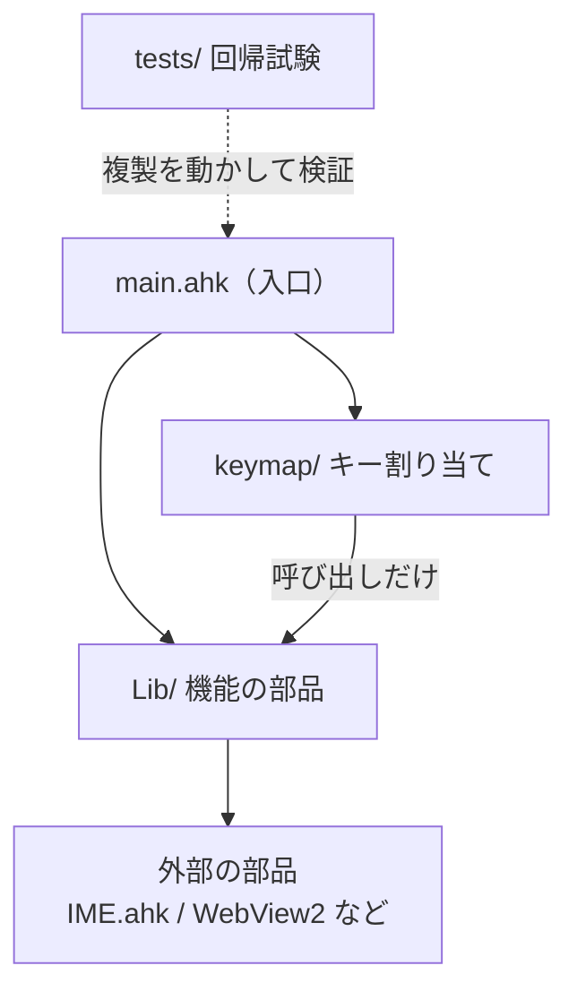

# プロジェクト全体の説明

AutoHotkey v2 で作った、キーボード中心の操作環境。ホームポジションから手を動かさずに、マウス操作・記号入力・ウィンドウ管理・日付入力などを済ませることが目的。

- 動作環境：Windows、AutoHotkey v2.0 以上、日本語 JIS 配列キーボード
- 実行：`main.ahk` を実行する。割り当てや設定を変えたら **Insert** で再読み込みする
- 個々のキー割り当ては文書に書かない（変えるたびに古くなるため）。正は `keymap/*.ahk` の行末コメントと、クイックメニュー A → K（Caps → j → a → k）の画面

## 設計の考え方

詳細は [principles.md](principles.md)。

- アプリに依存しない汎用の機能を中心にする。アプリ専用の機能は、使う頻度が高く覚える負担が小さいときだけ、別の部品として入れる
- ホームポジションを崩さない。使うのは親指キー（Space・変換・無変換）とホーム段まわりのキー
- キーには「地価」（ホームポジションからの近さ）がある。使う頻度が高い機能から、地価の高い空きへ置く。頻度の低いものはクイックメニューへ回す
- 3 つの領域を埋める：画面の対象をキーボードだけで操作する／画面や選択の中身を取り出して加工する／作業の文脈を覚えておく

## 全体の構造



- `main.ahk`：`Lib/` の部品を上から順に読み込み、そのあと `keymap/` を読み込む。Insert での再読み込みもここ
- `Lib/`：機能の本体。部品ごとに接頭辞（`QM_`、`Cap_`、`IH_`、`UI_` など）を付けて名前の重複を避ける
- `keymap/`：キー割り当て。呼び出しだけを書き、処理の本体は `Lib/` に置く
- `Lib/archive/`：使わなくなったもの（読み込まれない）

## キー操作の 3 つの層

| 種類 | ファイル | 動き |
| :--- | :--- | :--- |
| 押しながら使う | `keymap/hold_keys.ahk` | 変換 / 無変換 / Space を押したまま別のキー。末尾に 3 つの親指キーの短押し |
| 3 キー | `keymap/chord_keys.ahk`、`keymap/chord_ordered_keys.ahk` | 変換と無変換を両方押したままさらに別のキー。押す順番を区別する |
| 入力待ち | `keymap/leader_keys.ahk` | Caps / Space+F / Space+A を押して離し、次のキーで機能を選ぶ。かなキーはアプリ専用の入口 |

入力待ちの間は他の層のホットキーが止まる（`#HotIf !IH_waiting`）。

## 主な機能

使い方は [features.md](features.md)。

| 分類 | 機能 | 主な部品 |
| :--- | :--- | :--- |
| 文字入力 | IME 切り替え、直前の入力の再入力、日付入力、記号メニュー、Fn / Ctrl+数字の入力、Shift 長押しモード | `text_input` / `last_input` / `date_input` / `symbol_quick` / `oneshot_modifiers` / `shift_hold` |
| マウス・画面操作 | キーボードでのマウス移動・スクロール、Vimium C 風ヒント、カーソル移動モード | `mouse_cursor` / `vimium_c_hints` / `mouse_grid` |
| ウィンドウ | アプリ切り替え、タブ切り替え、モニター間移動、仮想デスクトップ、最前面・半透明 | `window_switch` / `window_ops` |
| ランチャー | クイックメニュー、コマンドパレット | `quick_menu` |
| 取り出して加工 | 選択文字の変換、検索・翻訳、マルチクリップボード、画面キャプチャ、付箋スクリーンショット、ウィンドウ内容の Markdown 書き出し | `text_ops` / `multi_clipboard` / `screen_capture` / `capture_pin` / `page_export` |
| 文章作成 | AI 下書きウィンドウ（WebView2 の入力欄） | `draft_window` |
| アプリ専用 | Outlook メール選択、Obsidian リンク選択、Office 図形編集、PowerPoint 詰め合わせ、VS Code 折りたたみ | `outlook_mail` / `obsidian_mode` / `office_common` / `powerpoint_pack` |
| 設定・保守 | キー割り当て・設定・クイックメニューの画面表示と編集、Box へのバックアップ、スクリーンセーバー回避 | `keymap_view` / `settings_view` / `quickmenu_view` / `screen_saver` |

## 共通の土台

- `config.ahk`：動作設定、ツールチップ番号などの定数、キーコード早見表
- `key_wait.ahk` / `key_mode.ahk`：入力待ちと、InputHook でキーを受けるモードの共通の骨組み
- `keymap_parse.ahk`：keymap の割り当て表を読む部品（画面表示・入力待ち一覧・キーの読み替えが共用）
- `chord.ahk`：3 キーの順番の記録と、割り当てのないキーを止める処理
- `ui_common.ahk`：ツールチップ、小窓の位置、モニター、UI Automation など表示まわり

## ディレクトリ構成

```
main.ahk            入口
keymap/             キー割り当て（hold / chord / chord_ordered / leader）
Lib/                機能の部品。webview2/ ComVar.ahk Promise.ahk IME.ahk は外部の部品（変更しない）
Lib/archive/        未使用の保管場所
tests/              キーの仕組みの回帰試験（harness.ahk、run_tests.ps1、cases/）
docs/               説明・方針・開発メモ・依頼・アイデア（archive/ は履歴）
quick_usage.ini     クイックメニューの使用回数
page_export.ini     ページ書き出しの設定
```

## 開発と検証

詳細は [development.md](development.md)。

- 構文の確認：`AutoHotkey64.exe /ErrorStdOut /validate main.ahk 2>&1`（終了コード 0 で出力がなければ問題なし）
- `tests/`：起点キー・3 キー・入力待ち・Shift 長押しの仕組みを変えたときだけ、`tests\run_tests.ps1 -Cases 名前` で流す。試験の間はキーボード・マウス・前面のウィンドウに触らない
- 設定ファイルに個人パスを絶対パスで書かない（`%USERPROFILE%` などを使う）

## ドキュメント一覧

| ファイル | 内容 |
| :--- | :--- |
| [../README.md](../README.md) | 概要・使い方・レイヤー構成 |
| [features.md](features.md) | 機能・モードの使い方 |
| [principles.md](principles.md) | 機能を足す・キーを割り当てるときの判断の基準 |
| [development.md](development.md) | ファイル構成、命名、検証、AutoHotkey v2 の落とし穴 |
| [backlog.md](backlog.md) | 依頼の一覧 |
| [ideas.md](ideas.md) | 未実装のアイデア |
